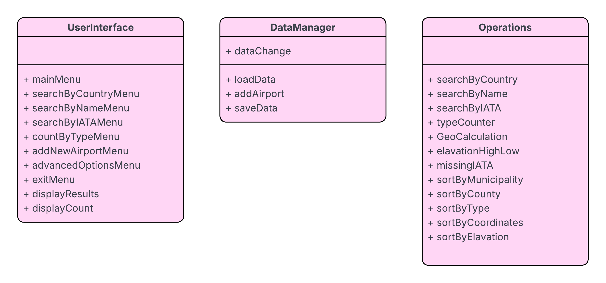

# Airport-Search-Engine
This search engine is a console-based C++ application, which can search, sort and analyze airport data. Users can also add new airports to the database.

## Technologies

This project makes use of C++, CSV file handling and object-oriented programming. Data management, program logic and the user interface are handled by separate classes. The IDE used was Visual Studio.

This project helped me learn to separate responsibilities between classes, processing a CSV and implementing searching and sorting logic.

## Features
- searching (by country, name, IATA)
- sorting (municipality, name, country, type, elevation, coordinates)
- count by type (small, large, heliport)
- get latitude/longitude
- find airport with lowest/highest elevation
- find distance between two given airports
- find distance to nearest airport from given point
- find airports in given radius from given point

## Classes 

## Getting Started

This program cannot be successfully ran as the data I was provided for this coursework is no longer available to me. However, the code making use of that data can still be viewed and ran.

### Requirements

- Microsoft Visual Studio with the C++ desktop development tools installed.

 ### Running the Application
1. Clone or download this repository.
2. Open the solution in Visual Studio.
3. Build the project.
4. Run the application.

## Author
Adam Pompa
